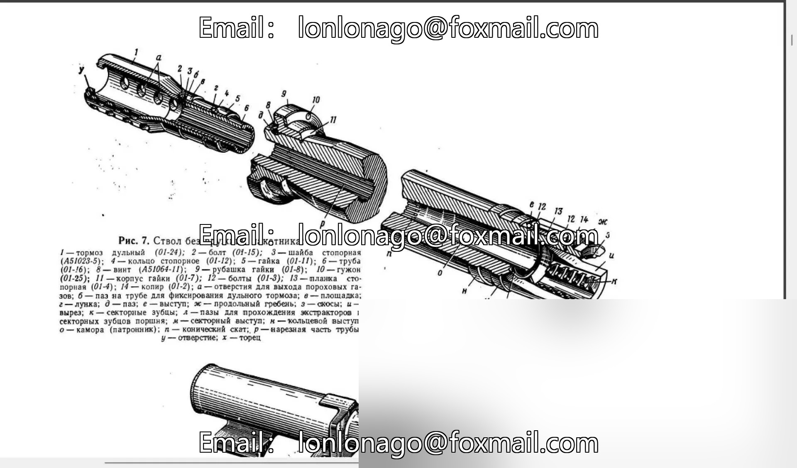
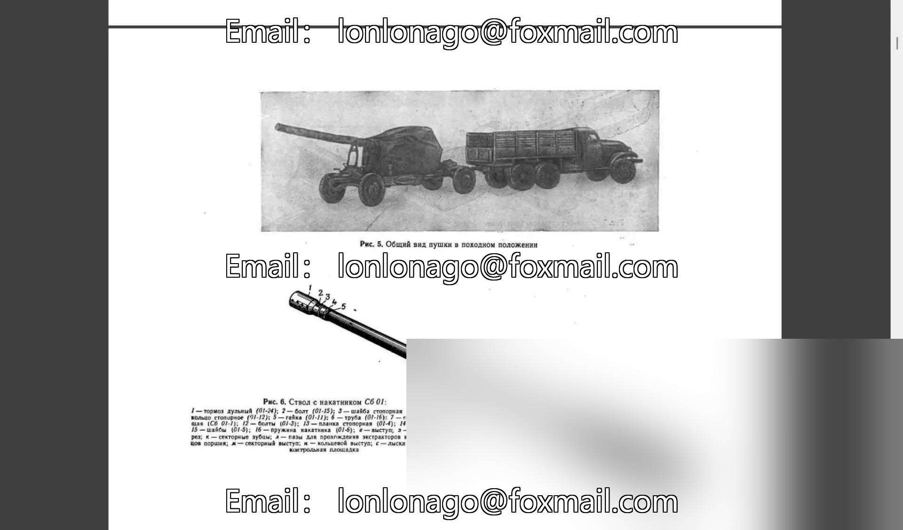
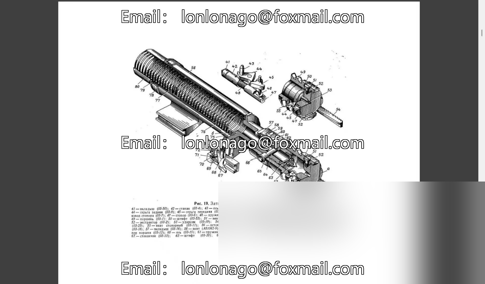
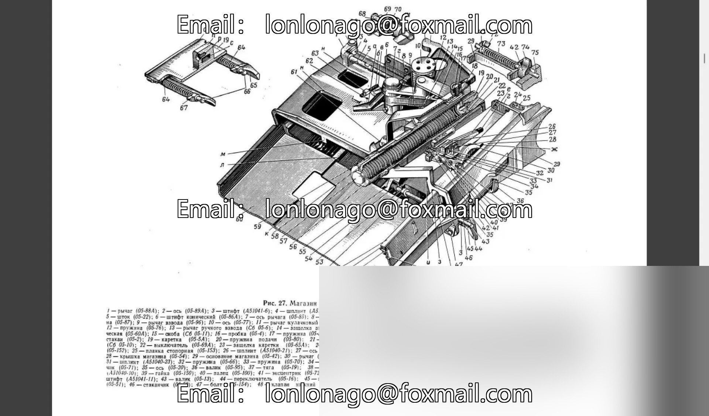
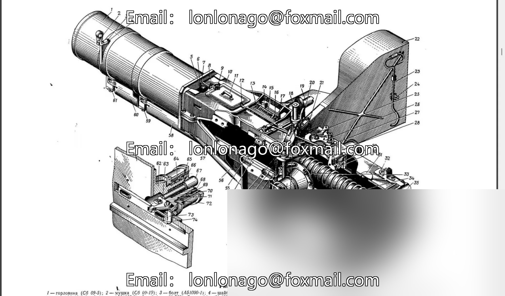
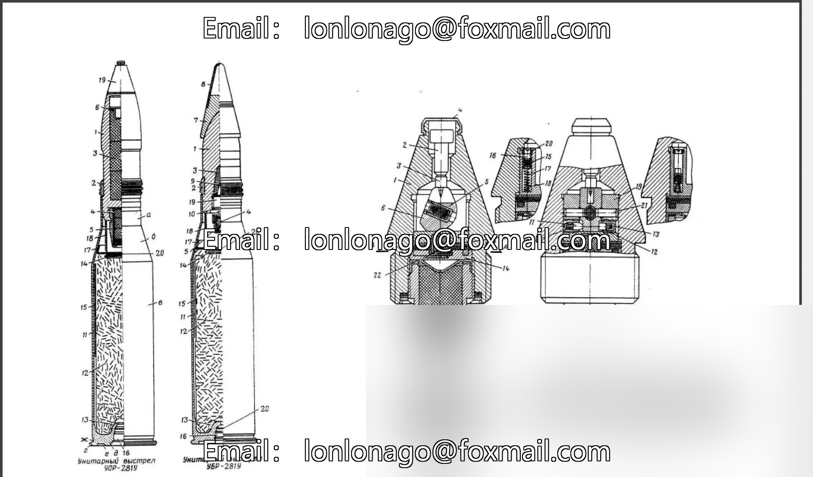

# 57mm S-60 automatic high-altitude artillery profile set

## Body

57mm S-60 automatic high-altitude artillery profile set
161 pages, Russian original version, covering detailed structural diagrams such as muzzle, barrel, and shell, suitable for enthusiasts of military, model making, and technical research.
non-refundable if sold, non-reclaimable.
Need to take photos directly, have questions, contact privately.

This is a set of 57-mm S-60 automatic anti-air gun drawings, containing 161 pages in Russian original, with detailed structure diagrams for the gun tube, gun carriage and ammunition, suitable for military enthusiasts, model making and technical research.

<!-- AI_ENRICHED -->

## Images

## Payment

Here is a pay link on Stripe ( https://buy.stripe.com/3cs8yP7sY87d0vu9AB ). Please contact me lonlonago@foxmail.com after funding $89, and I will send you a complete data files , thank you!

